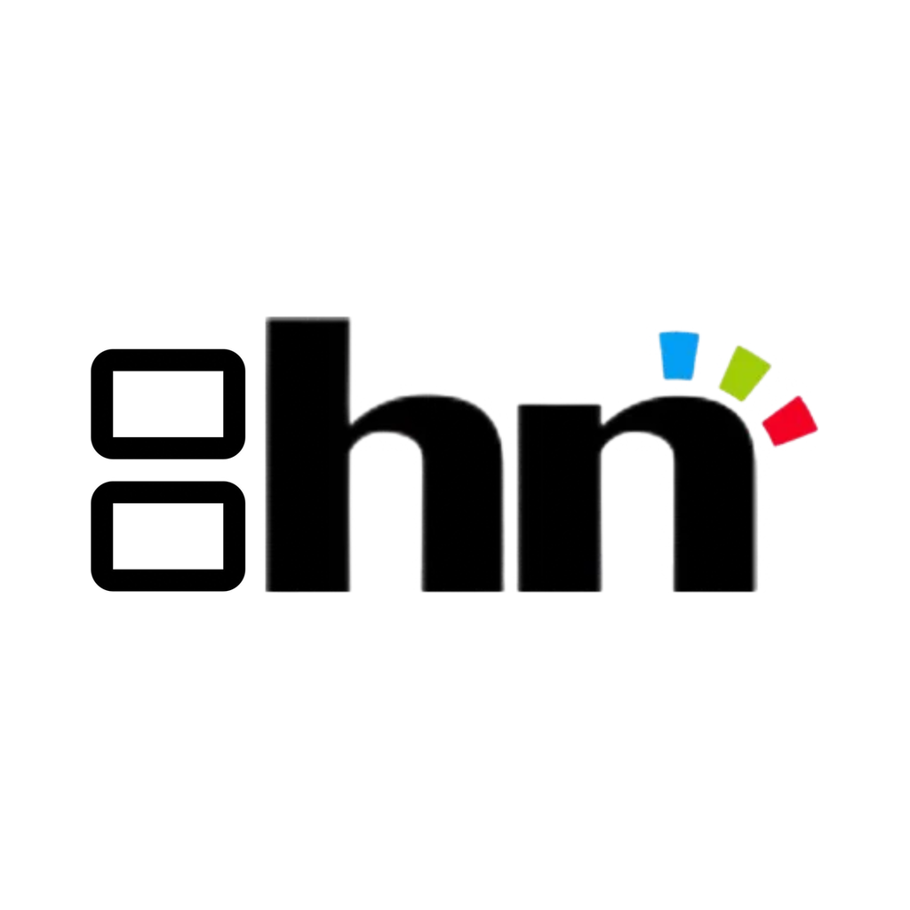

<p align="center"></p>

# 3DS Screen Link

Utilise ta (New) 3DS comme écran et manette sans fil pour ton PC Windows ou ton Mac.

- **Écran du haut** : copie de l'écran du PC, en direct
- **Écran du bas** : clavier tactile AZERTY
- **Boutons, Circle Pad, C-Stick** : manette Xbox 360 virtuelle sur le PC (ou touches clavier)
- **Connexion Wi-Fi** : la 3DS affiche son IP et son port, le PC s'y connecte
- **Son** : le son du PC est joué par la 3DS (32 kHz stéréo)
- **Mises à jour** : l'appli PC affiche un bouton dès qu'une nouvelle version est publiée sur GitHub

```
3ds-screen-link/
├── 3ds/                 appli homebrew 3DS (C, libctru + citro2d + libjpeg-turbo)
│   ├── source/main.c
│   ├── assets/          design des écrans d'attente (régénérer avec tools/make_assets.py)
│   ├── icon.png
│   └── Makefile
├── pc/                  appli PC (Python + Tkinter)
│   ├── screenlink_pc.py
│   └── requirements.txt
└── .github/workflows/   compilation automatique + releases
```

## Installation

### Sur la 3DS
Il faut une console avec le Homebrew Launcher (custom firmware Luma3DS).

1. Télécharge `ScreenLink3DS.3dsx` depuis la page [Releases](https://github.com/Heivoli-dev/3ds-screen-link/releases).
2. Copie-le dans le dossier `/3ds/` de la carte SD.
3. Lance-le depuis le Homebrew Launcher. L'écran du haut affiche **l'IP et le port**.

**Mises à jour de l'appli 3DS** : au lancement, l'appli vérifie sur GitHub (branche `builds`, mise à jour automatiquement à chaque release) si une nouvelle version existe. Si oui, l'écran du bas l'indique : appuie sur **Y** pour la télécharger et l'installer, puis relance l'appli.

**Pour le son**, la 3DS a besoin du fichier `dspfirm.cdc` dans `/3ds/` sur la carte SD. Si l'écran du bas affiche « Son indisponible », lance une fois l'appli **DSP1** (https://github.com/zoogie/DSP1/releases) depuis le Homebrew Launcher : elle crée ce fichier. Beaucoup de consoles l'ont déjà.

### Sur le PC (Windows 10/11)
1. Installe le pilote **ViGEmBus** (pour la manette virtuelle) : https://github.com/nefarius/ViGEmBus/releases
2. Télécharge `ScreenLinkPC.exe` depuis les [Releases](https://github.com/Heivoli-dev/3ds-screen-link/releases) et lance-le.
3. Si le pare-feu Windows demande l'autorisation, accepte pour les réseaux privés.
4. Au premier lancement, l'appli crée un raccourci **3DS Screen Link** sur le Bureau (bouton « Raccourci sur le Bureau » pour le recréer). Pour l'avoir dans la barre des tâches : clic droit sur son icône pendant qu'elle tourne → **Épingler à la barre des tâches**.

Ou depuis les sources : `pip install -r pc/requirements.txt` puis `python pc/screenlink_pc.py`.

### Sur Mac (macOS 12 ou plus récent, puce Apple M1/M2/M3/M4)
1. Télécharge `ScreenLinkPC-macOS.zip` depuis les [Releases](https://github.com/Heivoli-dev/3ds-screen-link/releases), décompresse-le et **glisse `ScreenLinkPC.app` dans le dossier Applications** (obligatoire pour les mises à jour automatiques).
2. **Premier lancement** : l'appli n'est pas signée par Apple, macOS la bloque. Ouvre-la une fois, puis va dans **Réglages Système → Confidentialité et sécurité** et clique sur **Ouvrir quand même** en bas de la page.
3. **Autorisations** (Réglages Système → Confidentialité et sécurité), active ScreenLinkPC dans :
   - **Enregistrement de l'écran** : pour copier l'écran (relance l'appli après) ;
   - **Accessibilité** : pour que le clavier tactile et les boutons de la 3DS tapent sur le Mac.
4. **Son (facultatif)** : macOS ne sait pas capturer le son du système tout seul.
   - Installe **BlackHole 2ch** (gratuit) : https://existential.audio/blackhole/
   - Ouvre **Configuration audio et MIDI**, clique sur **+** → **Créer un périphérique à sorties multiples**, coche tes haut-parleurs (en premier) **et** BlackHole 2ch.
   - Choisis ce périphérique à sorties multiples comme sortie son du Mac : tu entends le son sur le Mac et sur la 3DS.
   - Au premier envoi, macOS demande l'accès au « micro » : accepte, c'est BlackHole qui est lu.

Différence avec Windows : **pas de manette virtuelle sur Mac**, les boutons de la 3DS deviennent des touches clavier (mode « Clavier », réglable dans `~/Library/Application Support/3DS Screen Link/screenlink_config.json`). Mac Intel : lance l'appli depuis les sources (`pip install -r pc/requirements.txt`, puis `python3 pc/screenlink_pc.py`).

## Utilisation
1. Lance l'appli sur la 3DS (PC et 3DS sur le même réseau Wi-Fi).
2. Dans l'appli PC, entre l'IP et le port affichés sur la 3DS.
3. Clique sur **OFF** pour passer à **ON**. Le journal indique si la console est connectée et affiche les erreurs éventuelles. En cas de coupure, l'appli se reconnecte toute seule.
4. La 3DS passe automatiquement à la copie d'écran, au clavier et à la manette.

| Sur la 3DS | Action |
|---|---|
| START (écran d'attente) | Quitter |
| L + R + SELECT (connecté) | Quitter |
| Maj / Ctrl / Alt (tactile) | Modificateur appliqué à la touche suivante |

### Correspondance de la manette (mode Xbox)
A→A, B→B, X→X, Y→Y, L→LB, R→RB, ZL→LT, ZR→RT, START→Start, SELECT→Back, Croix→Croix directionnelle, Circle Pad→stick gauche, C-Stick (New 3DS)→stick droit.

### Circle Pad
L'option **Circle Pad** de l'appli PC choisit ce que fait le joystick gauche en mode Xbox :
- **Stick gauche + touches ZQSD** (par défaut) : marche dans les jeux compatibles manette **et** dans ceux qui n'acceptent que le clavier
- **Stick gauche (manette)** uniquement
- **Touches ZQSD (clavier)** uniquement

Le journal affiche « Circle Pad reçu de la console » dès que le joystick est bougé, ce qui permet de vérifier la connexion.

### Mode clavier
Si tu choisis « Clavier » (ou si ViGEmBus n'est pas installé), les boutons deviennent des touches. Le mapping se règle dans `screenlink_config.json`, créé à côté de l'appli au premier lancement (par défaut : Circle Pad = ZQSD, croix = flèches, A = Entrée, B = Échap...).

### Réglages
- **Images/s** et **Qualité** : baisse-les si l'image saccade. Le Wi-Fi de la 3DS est lent : compte environ 10 à 20 images/s sur New 3DS, moins sur une 3DS classique.
- **Écran n°** : choisit le moniteur à copier si tu en as plusieurs.
- **Étirer l'image** : remplit tout l'écran 3DS au lieu de garder les proportions.
- **Envoyer le son du PC à la 3DS** : capture ce qui sort des haut-parleurs par défaut de Windows.
- **Couleurs pleine résolution** : texte et couleurs plus nets (JPEG 4:4:4), images environ deux fois plus lourdes. Décoche-la si ça saccade.

## Compiler soi-même

**3DS** : installe [devkitPro](https://devkitpro.org/wiki/Getting_Started), puis
```
dkp-pacman -S 3ds-dev 3ds-libjpeg-turbo 3ds-curl
cd 3ds && make
```

**PC** :
```
pip install -r pc/requirements.txt pyinstaller
cd pc && pyinstaller --onefile --noconsole --name ScreenLinkPC --collect-all vgamepad screenlink_pc.py
```

## Publier une mise à jour
1. Change `VERSION = "1.0.1"` en haut de `pc/screenlink_pc.py`.
2. Pousse sur `main`.

GitHub Actions compile les deux applis (la version 3DS prend le même numéro) et crée la release `v1.0.1`. Les applis PC déjà installées voient le bouton **Mettre à jour** au prochain lancement (vérification toutes les heures).

## Code signing policy

Free code signing provided by [SignPath.io](https://about.signpath.io), certificate by [SignPath Foundation](https://signpath.org).

> Candidature en cours : tant qu'elle n'est pas acceptée, `ScreenLinkPC.exe` n'est pas signé et Windows SmartScreen peut afficher un avertissement au premier lancement (« Informations complémentaires » → « Exécuter quand même »).

Seul `ScreenLinkPC.exe` est signé. Il est compilé par GitHub Actions à partir du code de ce dépôt (voir `.github/workflows/build.yml`), et chaque signature est approuvée manuellement.

Rôles :
- **Auteurs (committers)** et **relecteurs (reviewers)** : [Heivoli-dev](https://github.com/Heivoli-dev)
- **Approbateurs (approvers)** : [Heivoli-dev](https://github.com/Heivoli-dev)

## Confidentialité

Ce programme ne transfère aucune information à d'autres systèmes en réseau, sauf à la demande de l'utilisateur ou de la personne qui l'installe ou l'utilise :

- **Vers la 3DS** : l'image de l'écran, le son et les touches transitent uniquement entre le PC et la console dont l'utilisateur saisit l'adresse IP, sur son réseau local, quand il clique sur ON. Le son peut être désactivé (case « Envoyer le son du PC à la 3DS »).
- **Vers GitHub** : pour proposer les mises à jour, l'appli PC et l'appli 3DS interrogent `api.github.com` (numéro de la dernière version) et ne téléchargent la mise à jour que si l'utilisateur la demande. Aucune donnée personnelle n'est envoyée, mais GitHub voit l'adresse IP de la requête (voir la [déclaration de confidentialité de GitHub](https://docs.github.com/site-policy/privacy-policies/github-general-privacy-statement)). Sur PC, la recherche se désactive avec la case « Rechercher les mises à jour au démarrage ».

Aucune statistique, aucun compte, aucune publicité.

## Licence et crédits

- Code : [licence MIT](LICENSE), © 2026 [heivoli-network.fr](https://heivoli-network.fr).
- Logo heivoli-network et design des écrans d'attente (`assets/`, `3ds/assets/`) : © 2026 heivoli-network.fr.
- Chiffres de l'IP et du port dessinés avec la police [Poppins](https://fonts.google.com/specimen/Poppins) (SIL Open Font License).
- Bibliothèques : libctru, citro2d, citro3d, libjpeg-turbo, libcurl, mbedTLS (3DS) ; mss, Pillow, pynput, vgamepad/ViGEm, PyAudioWPatch, PyInstaller (PC), chacune sous sa propre licence open source.

## Protocole
TCP, la 3DS est le serveur (port 8334). Chaque paquet : `[type: 1 octet][taille: 4 octets big-endian][données]`.

| Sens | Type | Contenu |
|---|---|---|
| PC → 3DS | `0x10` HELLO | version du PC |
| PC → 3DS | `0x11` FRAME | image JPEG 400×240 |
| PC → 3DS | `0x13` BYE | déconnexion |
| PC → 3DS | `0x14` AUDIO | 20 ms de son IMA ADPCM 32 kHz : canaux (u8), état de chaque canal (s16 + u8), puis les données |
| 3DS → PC | `0x01` HELLO | version de l'appli 3DS |
| 3DS → PC | `0x02` INPUT | boutons (u32) + Circle Pad x/y + C-Stick x/y (s16) |
| 3DS → PC | `0x03` KEY | appui/relâchement (u8), modificateurs (u8), nom de la touche |
| 3DS → PC | `0x04` ACK | image affichée, le PC peut envoyer la suivante |

Le PC attend l'ACK avant d'envoyer l'image suivante, ce qui limite la latence au lieu d'accumuler du retard.

---

<p align="center">© 2026 <a href="https://heivoli-network.fr">heivoli-network.fr</a></p>
